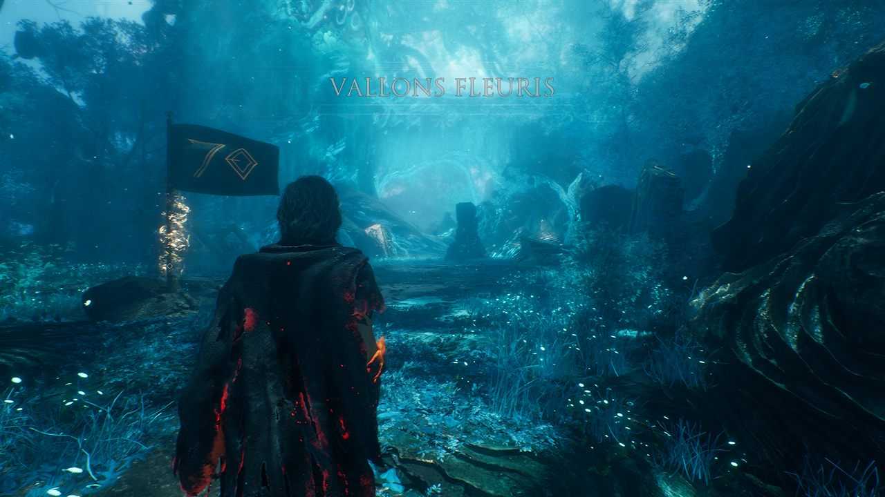
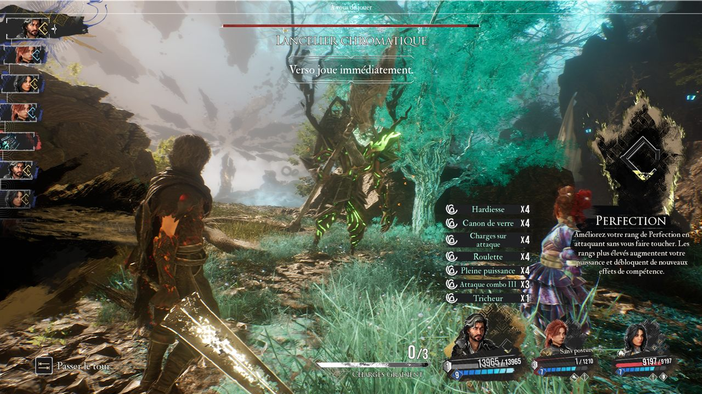
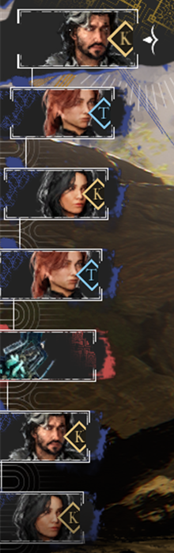
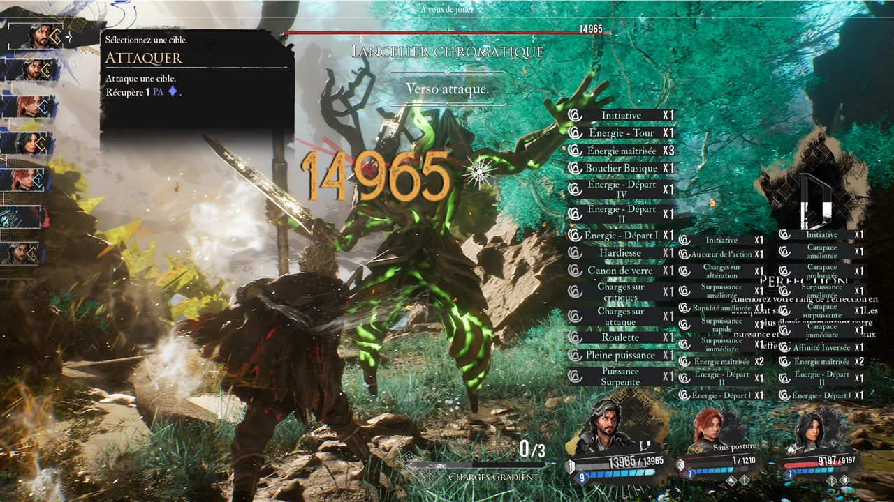
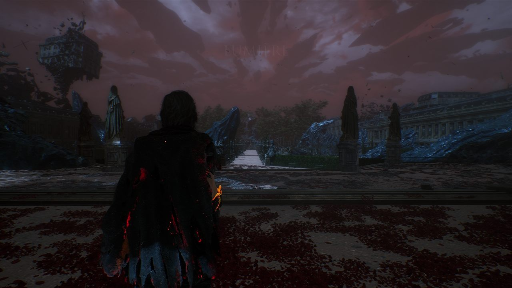
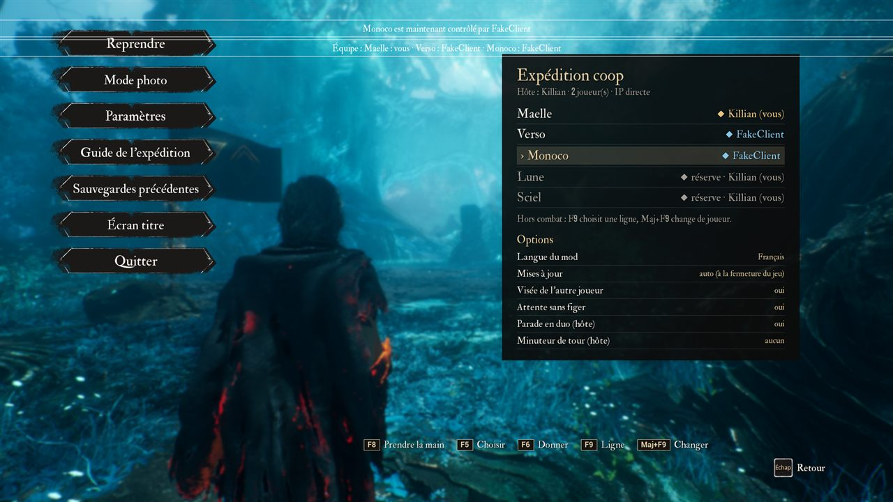

<div align="center">

# Expedition 33 · Coop en ligne

**Un vrai mode coopératif en ligne, de 2 à 3 joueurs, pour _Clair Obscur: Expedition 33_.**
Chacun joue sur son PC, avec son propre jeu. Pas de streaming vidéo : les parties se synchronisent par le réseau Steam.
Un seul fichier à installer, puis le mod se met à jour tout seul.



<a href="https://github.com/kipavy/e33-coop/actions/workflows/build.yml"></a>


<a href="LICENSE"></a>
<a href="https://ko-fi.com/kipavy"></a>

</div>

> [!WARNING]
> **En développement.** Le mod est testé automatiquement sur un PC et en vraies parties à deux PC entre amis. Les versions sont publiées dans les [releases](https://github.com/kipavy/e33-coop/releases) de ce dépôt ; il n'y a pas encore de version stable, et des bugs sont attendus. Mod non officiel, sans lien avec Sandfall Interactive ni Kepler Interactive.

---

## L'idée

Dans Expedition 33, le combat au tour par tour repose sur des **réflexes** : parades, esquives, sauts et timings de compétences. Si on les jouait à distance, la latence réseau les rendrait injouables. Ce mod fait donc tourner **le jeu complet chez chaque joueur** :

- **L'hôte décide de tout ce qui est aléatoire ou choisi par l'IA** : dégâts, critiques, actions ennemies, ordre des tours. Il diffuse des résultats, pas des touches.
- **Chaque joueur résout ses propres réflexes sur son PC, sans latence.** C'est vrai pour les parades et esquives de ses personnages comme pour leurs timings d'attaque et leurs tirs en visée libre. Le résultat part ensuite chez les autres.
- **Une empreinte de l'état du combat est comparée à chaque tour.** Au moindre écart, l'état de l'hôte est réappliqué.

## Ce que ça donne

<table>
<tr>
<td width="72%"></td>
<td><br><sub>Dans l'ordre des tours, un losange porte l'initiale du pseudo du joueur qui contrôle chaque héros (ici <b>K</b>illian et <b>T</b>OTOFF), avec une couleur par joueur.</sub></td>
</tr>
</table>

| | |
|---|---|
|  |  |
| Chaque joueur joue les tours de ses personnages et pare les coups qui les visent. | Exploration : un pilote, les autres le suivent, d'une zone à l'autre. |


<sub>Le panneau **Coop** du menu pause : qui joue quel personnage (ici Monoco vient d'être donné à l'autre joueur avec **F9** puis **Maj+F9**), et les options du mod.</sub>

## Fonctionnalités

Les cases cochées passent les tests automatiques. « À valider » signifie : écrit et compilé, en attente d'une vraie partie à deux.

**Combat**
- [x] Ordre des tours, actions, compétences, objets, fuite et passage de tour synchronisés
- [x] Parades, esquives et sauts résolus par le joueur qui contrôle le héros
- [x] Timings des compétences et visée libre résolus localement, puis rejoués chez les autres
- [x] Attente du début de tour de l'hôte sans figer le jeu (plus de mini-freezes à la fin des compétences)
- [x] Vérification de l'état à chaque tour et réparation automatique des écarts
- [x] Récompenses de fin de combat identiques pour tous
- [x] Attaque surprise et équipe de l'hôte appliquées chez tous
- [x] Losanges de joueur dans l'ordre des tours
- [x] Voir ce que l'autre joueur prépare : son action et sa cible s'affichent avant qu'il ne joue
- [ ] Menus synchronisés : voir en direct les menus de l'autre s'ouvrir et se fermer (roue d'actions, compétences, gradients, cible) et sa sélection active, sans pouvoir y toucher *(prochaine mise à jour)*
- [ ] Bonus « parade en duo » : +1 PA si chaque joueur pare la même attaque de groupe *(à valider)*
- [x] Vue de la visée libre de l'autre joueur depuis l'épaule de son personnage

**Exploration et session**
- [x] Rejoindre à tout moment : l'hôte envoie un instantané de sa partie, chargé dans un emplacement coop séparé
- [x] Pilote et suiveurs, changements de zone, dialogues et cinématiques avec point de rendez-vous
- [x] Nouvelle partie ensemble : chacun voit la cinématique d'introduction
- [x] Pause partagée en combat, avec le nom de qui a mis en pause
- [x] Départs et retours de joueurs : l'hôte reprend les héros d'un joueur parti
- [x] Écrans d'attente qui disent ce que fait l'autre (« En attente de TOTOFF, qui regarde une cinématique »)
- [x] Sauvegarde côté client : copie à jour de la partie commune, hébergeable avec **F10**, sans toucher aux sauvegardes perso
- [ ] Bouton « Rejoindre *ami* » dans le menu principal *(à valider)*
- [x] Panneau « Coop » dans le menu pause : qui joue qui, répartition des personnages et options au clavier (**F9**)

**Réseau**
- [x] Steam Networking Messages : P2P avec relais Steam, lobby « amis seulement », invitation par l'overlay
- [x] Vérification des versions du jeu, du mod et du protocole, avec un message clair en cas d'écart
- [ ] Mode test à distance pour le développement : commandes en liste fermée, journaux renvoyés par Steam *(à valider)*

**Installation et mises à jour**
- [ ] Un seul fichier à télécharger, `Installer E33 Coop.exe`, qui trouve le jeu et installe tout *(à valider)*
- [ ] **Mises à jour automatiques** : le mod télécharge la dernière version publiée et l'installe à la fermeture du jeu ; rejoindre un ami plus à jour met à jour tout de suite *(à valider)*
- [ ] Aucune option de lancement : on invite (F7) ou on rejoint depuis le jeu *(à valider)*

## Installer

Il faut **la même version du jeu** (Steam) chez tous les joueurs. La version du mod se met à jour toute seule.

1. Télécharger **`Installer.E33.Coop.exe`** depuis la [dernière release](https://github.com/kipavy/e33-coop/releases/latest). Un seul fichier, rien à décompresser.
2. Double-cliquer dessus, jeu fermé, puis cliquer **Installer**.
   - L'installateur trouve le jeu tout seul, même dans une autre bibliothèque Steam (par exemple `E:\SteamLibrary`). Sinon, *Choisir le dossier du jeu…*.
   - Il télécharge le paquet de la release depuis GitHub, vérifie son **empreinte SHA-256**, puis installe UE4SS et le mod dans le dossier `Sandfall\Binaries\Win64` du jeu. Rien d'autre n'est modifié. L'ancien contenu est gardé dans `Win64\e33coop-backup-<date>`.
3. Lancer le jeu normalement par Steam, **sans option de lancement**.

> [!NOTE]
> L'installateur n'est pas signé. La première fois, Windows peut afficher « Windows a protégé votre ordinateur ». Cliquer *Informations complémentaires*, puis *Exécuter quand même*.

Le même fichier sert à **mettre à jour**, à changer les **options** et à **désinstaller** (les sauvegardes ne sont jamais touchées). Sans Internet : poser `e33coop-player.zip` et `SHA256SUMS` de la release à côté de l'installateur. Les scripts `install.ps1` / `uninstall.ps1` du zip restent disponibles.

**Mises à jour.** Au menu principal, le mod regarde s'il existe une nouvelle release. Par défaut, il la télécharge, vérifie son empreinte et l'installe **à la fermeture du jeu** : jamais de redémarrage en pleine partie. Si l'on rejoint un ami qui a une version plus récente, la mise à jour se fait tout de suite, le jeu redémarre et rejoint la partie de l'ami.

## Jouer

Aucun rôle à choisir à l'avance : il se décide en jeu.

1. **Inviter.** Charger sa partie, puis **F7** : la partie s'ouvre au coop et la fenêtre d'invitation Steam s'ouvre.
2. **Rejoindre.** Au menu principal, cliquer **Rejoindre *ami*** (ou **F7**), ou accepter l'invitation Steam, jeu ouvert ou fermé. On entre dans la partie de l'ami au prochain moment calme : hors combat, cinématique et chargement.
3. **Fin.** Retour au menu principal : on peut à nouveau inviter ou rejoindre.

Une invitation acceptée en pleine partie attend le retour au menu principal, pour ne pas perdre la progression.

| Touche | Qui | Effet |
|---|---|---|
| **F7** | partie chargée | Ouvrir la partie au coop, inviter des amis Steam |
| **F7** | au menu principal | Rejoindre la partie coop d'un ami |
| **F8** | tous | Prendre la main en exploration (devenir le pilote) |
| **F5** / **F6** | hôte, hors combat | Choisir un personnage / le donner au joueur suivant |
| **F9** / **Maj+F9** | tous | Choisir une ligne du panneau Coop (personnage ou option) / la changer |
| **F10** | au menu principal | Héberger la copie coop gardée lors des parties chez un ami |
| **U** | au menu principal | Installer la mise à jour proposée (option `updates = ask`) |

Les raccourcis sont rappelés dans le panneau **Coop** du menu pause.

## Options

Les options se changent en jeu (**F9** puis **Maj+F9**, dans le panneau Coop du menu pause), dans l'installateur (*Options*), ou à la main dans `Sandfall\Binaries\Win64\ue4ss\Mods\E33Coop\settings.ini` :

| Option | Valeurs | Effet |
|---|---|---|
| `lang` | `auto` · `fr` · `en` | Langue des textes du mod (`auto` : celle de Windows) |
| `updates` | `auto` · `ask` · `off` | Mises à jour : à la fermeture du jeu, sur demande (touche **U**), ou jamais |
| `aim_cam` | `1` · `0` | Vue de la visée libre de l'autre joueur depuis son épaule |
| `turndep` | `1` · `0` | Attente du tour de l'hôte sans figer le jeu (`0` : ancienne attente bloquante) |
| `duo_parry` | `1` · `0` | Bonus « parade en duo » (réglage de l'hôte, valable pour tous) |
| `turn_timer_s` | `0` · `30` · `60` · `90` | Minuteur de tour en secondes (réglage de l'hôte, `0` : aucun) |

Les options de l'hôte s'appliquent à toute la partie ; chez un client, elles s'affichent en lecture seule.

<details>
<summary>Options de lancement (développement)</summary>

Les options `-e33…` gardent la priorité sur `settings.ini` : `-e33lang`, `-e33updates`, `-e33aimcam`, `-e33turndep`, `-e33duoparry`, `-e33turntimer`. Avec `-e33role=host|client`, le mod reprend l'ancien fonctionnement : rôle fixé au lancement, `-e33transport=steam` pour Steam, UDP sinon (`-e33port`, `-e33connect`), `-e33join=1` pour rejoindre. Les scénarios de test ne lisent que leurs propres `launch_args`.

</details>

## Sous le capot

```
native/
  hooks/       accès au jeu : appels Blueprint, lecture des propriétés, crochets avant/après
  net/         lien fiable sur UDP ou Steam Networking Messages, lobbies Steam
  protocol/    messages versionnés et validés (un message invalide est ignoré, jamais fatal)
  sync/        combat (coop.cpp), exploration et session (explore.cpp), builds, copie coop, présence
  ui/          textes FR/EN, cartes d'information du jeu, losanges et panneau pause
  remote/      mode test à distance (canal Steam séparé, commandes en liste fermée)
  testrunner/  joueur automatique piloté par des scénarios JSON
tools/
  fakepeer/    faux hôte ou faux client qui rejoue des parties enregistrées
  run-scenario/ lancement d'un scénario, batterie de non-régression
  installer/   « Installer E33 Coop.exe » : installation, mises à jour, options, désinstallation
  package/     paquet joueur, scripts d'installation et de désinstallation
```

- **Pas de compilation locale.** Chaque push est compilé par GitHub Actions (mod, outils, tests unitaires).
- **Tests en vrai jeu.** Un scénario lance le jeu, un faux joueur rejoue une partie enregistrée, et le joueur automatique combat, pare, vise et explore. Le scénario vérifie ensuite des dizaines de compteurs : écarts d'état, tirages aléatoires, récompenses, attentes. La batterie compte plus de 40 scénarios.
- **Publier une version.** Mettre le numéro dans `VERSION`, committer, puis pousser le tag `vX.Y.Z` correspondant. La CI compile en mode release, fait le paquet et publie la release (zip, installateur, `SHA256SUMS`). Détails : [`docs/RELEASE.md`](docs/RELEASE.md).
- **Documentation :**
  - [`docs/PROGRESS.md`](docs/PROGRESS.md) : l'état du projet ;
  - [`docs/DECISIONS.md`](docs/DECISIONS.md) : les décisions ;
  - [`docs/GAME-INTERNALS.md`](docs/GAME-INTERNALS.md) : les fonctions du jeu utilisées ;
  - [`docs/REMOTE-TEST.md`](docs/REMOTE-TEST.md) : le mode test à distance.

## Licence

Copyright © 2026 Killian ([kipavy](https://github.com/kipavy)).

Le code de ce dépôt est distribué sous la licence **[GNU GPL v3.0](LICENSE)**. Vous pouvez l'utiliser, l'étudier, le modifier et le redistribuer. Toute version modifiée que vous distribuez doit rester sous GPL v3, avec son code source.

La licence couvre le code du mod uniquement. *Clair Obscur: Expedition 33* et ses contenus appartiennent à leurs ayants droit. UE4SS est distribué sous sa propre licence (MIT).

## Soutenir

Le projet vous plaît ? Un café aide à le faire avancer :

<a href="https://ko-fi.com/kipavy"></a>

---

<sub>Projet personnel entre amis. Aucun fichier du jeu n'est inclus ni modifié : le mod s'appuie sur <a href="https://github.com/UE4SS-RE/RE-UE4SS">UE4SS</a>. Les captures viennent des tests automatiques.</sub>
